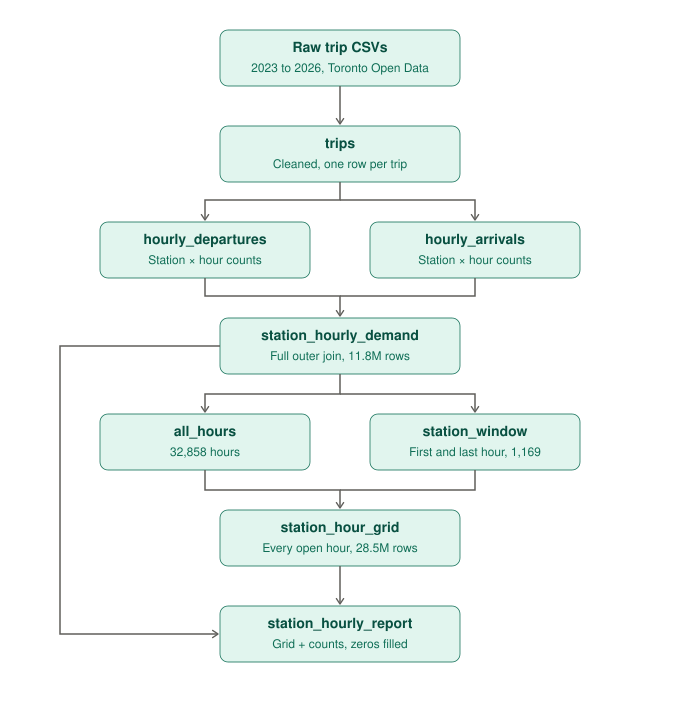

# Toronto Bike Share Predictiion

Predicting when Bike Share Toronto stations will run out of bikes, using historical trip data and like station status.

## Status
Four years of trip data (2023–2026) are cleaned and loaded into SQLite, and an hourly demand table covering every station is built, including hours with no trips. Next: adding hourly weather, social ecenomic region then features and a first forecasting model.

## Data
- Trip history: [Bike Share Toronto Ridership Data](https://open.toronto.ca/dataset/bike-share-toronto-ridership-data/) (Toronto Open Data)
- Live station status: Bike Share Toronto GBFS feed

Data files are not included in this repo. Download the trip CSVs into `data/raw/`.

## Setup
    python -m venv .venv
    source .venv/bin/activate
    pip install -r requirements.txt

## Data Pipeline

*Pipeline diagram created with Claude (Anthropic).*

1. **Collection.** Trip records for 2023–2026 come from the Bike Share Toronto Ridership dataset on Toronto Open Data, published as monthly or yearly CSVs.

2. **Cleaning.** Each year is cleaned in its own notebook with the same rules,
   then appended to one `trips` table in SQLite:
   - Removed trips under 60 seconds (glitches and redocks).
   - Removed trips over 3.6 hours (12,875 s, the 99.9th percentile of 2026), which are likely lost or unreturned bikes. The same cutoff is applied to every year for consistency.
   - Removed round trips under 2 minutes (undocking and redocking a bad bike).
   - Kept trips with no end station: they still left a real station, so they count as departures, but not as arrivals.

3. **Hourly demand.** Built separate tables of hourly departures and arrivals per station, then combined them into one table with both counts side by side.

4. **Filling quiet hours.** The hourly tables only contained hours with trips, so quiet hours were missing rather than zero. I built a full grid of every station × every hour it was active, then attached the counts and filled the gaps with 0. This grew the table from 11.8M to 28.5M station-hours; about 59% of station-hours have no trips.

## Weather data

Hourly weather comes from Environment and Climate Change Canada (ECCC), station **Toronto City**, downloaded through the Climate Data Extraction Tool as four CSV files covering 2023–2026.

**Columns kept:** temperature (°C), precipitation (mm), relative humidity (%). Wind speed and the text weather description were empty for this station and period, so they were dropped.

**Time zone.** ECCC times are in UTC, while trip times are Toronto local time (UTC−5 in winter, UTC−4 in summer). Times were parsed as UTC and converted to `America/Toronto` before formatting into the same `hour` text used by the demand table (`YYYY-MM-DD-HH:00`). Joining without this conversion would have attached weather from the wrong hour, 4–5 hours off.

**Daylight saving.**
- *Fall back:* the 1 a.m. hour occurs twice each November, giving duplicate `hour` labels (4 pairs). Each pair was combined: temperature and humidity averaged, precipitation summed, since trip counts for that hour also cover both real hours.
- *Spring forward:* the 2 a.m. hour each March doesn't exist in Toronto time. These four hours were removed.

**Missing hours.** After trimming to Jan 1, 2023 – Oct 1, 2026, 34 real hours had no reading: mostly single hours plus a few 4–5 hour blocks (several on weekdays at 10:00–14:00, likely station maintenance). The longest gap was 5 hours.
- Temperature and humidity were filled by linear interpolation (limit 6 hours).
- Precipitation in those hours was set to 0.
- A `weather_filled` column marks every estimated hour.

**Bug caught:** the first version of the `hour` format swapped month and day (`%d` and `%m`), which would have joined November weather to June trips. Inspecting the duplicate rows revealed it.